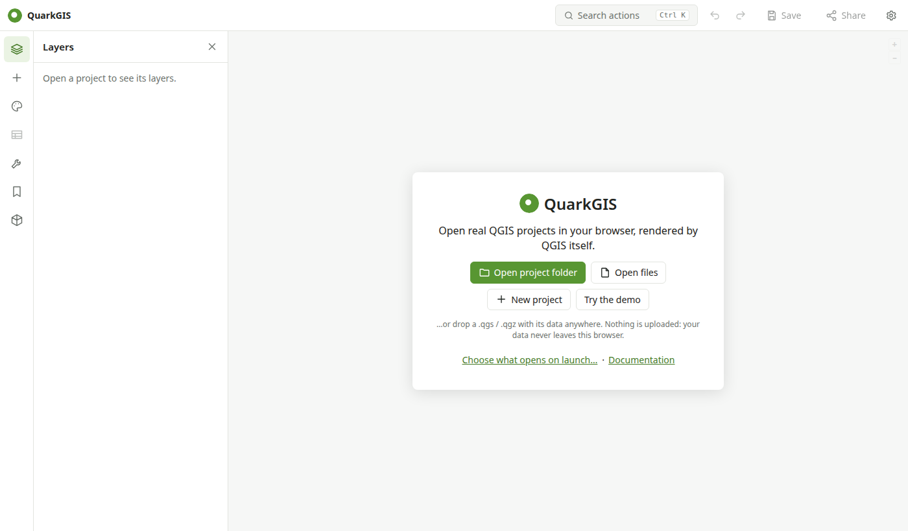

# Getting started

## Requirements

A recent desktop **Chrome, Edge or Firefox**. The QGIS engine is about 20 MB; it is downloaded once and then cached. Phones and tablets work for viewing, with a simplified layout.

## Open the app

Go to **<https://ismailsunni.id/quarkgis/>**. The start page offers:

- **Open project folder**: pick the folder holding your `.qgz` and its data. Use this when the project reads files next to it.
- **Open files**: pick a `.qgs` / `.qgz` and its data files, or a GeoPackage with an embedded project.
- **New project**: an empty project, then add data.
- **Try the demo**: a world map from Natural Earth.
- **Saved in this browser**: projects you saved earlier.

You can also drop files or a whole folder anywhere on the page.

!!! tip "Open a project from the web"
    Add `?url=` to the address: `https://ismailsunni.id/quarkgis/?url=https://example.org/maps/project.qgz`. Relative data paths are fetched next to the project, so the server must allow cross-origin requests (CORS).

## A first tour

1. Click **Try the demo**.
2. **Layers** (left rail): switch layers on and off, drag to reorder, click a layer to make it current.
3. **Style**: change how the current layer is drawn, for example *Graduated* on `POP_EST`.
4. **Attribute table**: browse, filter and select features; selected features are highlighted on the map.
5. Click a country on the map to **identify** it.
6. **Save** opens a menu: save in this browser (++ctrl+s++), download the project file (`.qgz`), or download the project with its data (`.zip`).

Press ++ctrl+k++ (++cmd+k++ on a Mac) at any time to search every action, and ++question++ to see the keyboard shortcuts.

## Interface

| Area | What's there |
| --- | --- |
| Top bar | Project name (click for properties), action search, undo/redo, Save, Share, Settings |
| Left rail | Layers, Add data, Style, Attribute table, Processing, Bookmarks, QGIS Hub |
| Map toolbar (right) | Previous/next view, selection tools, measure, elevation profile, time slider, grid, legend, map tips, compare, export image |
| Status bar | Pointer coordinates (click to change the format), scale, project CRS |

Right-click the map for coordinates in every format, identify, center, zoom and bookmark.

## Where your data lives

Files you open are copied into the browser's private storage (OPFS) for the session. **Save** keeps the project and its data there until you delete it. Unsaved work is autosaved, and offered back if the tab closes unexpectedly. To move a project elsewhere, download it as a `.zip`.
