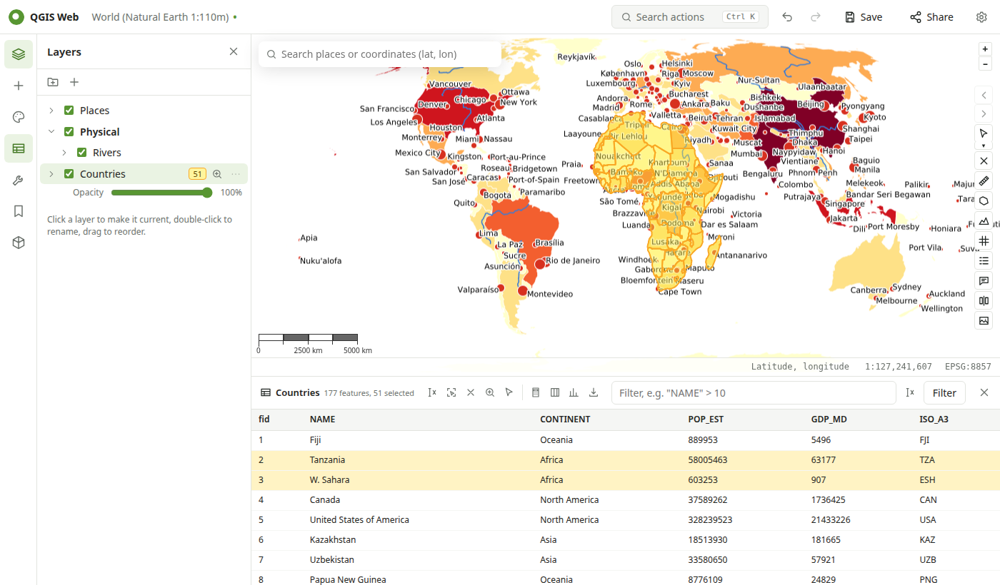

# Attributes and selection

## Attribute table

Open it with the **table** button in the left rail (for the current layer) or from the layer menu.

- Scrolls smoothly through hundreds of thousands of features; click a column header to sort.
- **Filter** with a QGIS expression, e.g. `"POP_EST" > 10000000`; the expression builder (`ƒx`) lists fields, values and QGIS's functions, with a live preview.
- Click a row to select the feature and zoom to it; ++ctrl++ adds or removes rows, ++shift++ selects a range.
- **Show selected only**, invert or clear the selection, zoom to it.
- Double-click a cell to edit it while the layer is in edit mode. Value maps, aliases, hidden fields and constraints from the project's attribute form are respected.

## Selecting on the map

The **select** button in the map toolbar has a menu: by click, rectangle, polygon or freehand. Hold ++shift++ to add to the selection and ++ctrl++ to remove from it. Selected features are highlighted on the map and in the table, and their count is shown next to the layer.

Also: **Select by expression** and **Select by location** (features that intersect, contain, or are within features of another layer), from the table or the action search.

## Statistics

The **statistics** button in the table summarizes a field over the rows shown (all, filtered, or selected): count, sum, mean, median, min, max, standard deviation and unique values for numbers, with a histogram; the most frequent values for text. **Copy** puts the table on the clipboard.

## Field calculator and fields

- **Field calculator**: create or update a field from a QGIS expression; the first feature's result is previewed.
- **Fields**: add, rename and delete fields.

Both write to the layer's GeoPackage (other formats are converted first) and can be undone.

## Exporting a layer

**Export…** (table toolbar or layer menu) downloads the layer as GeoPackage, FlatGeobuf or CSV with WKT geometry in the layer's CRS, or as GeoJSON, Shapefile (zip) or KML in WGS 84.
