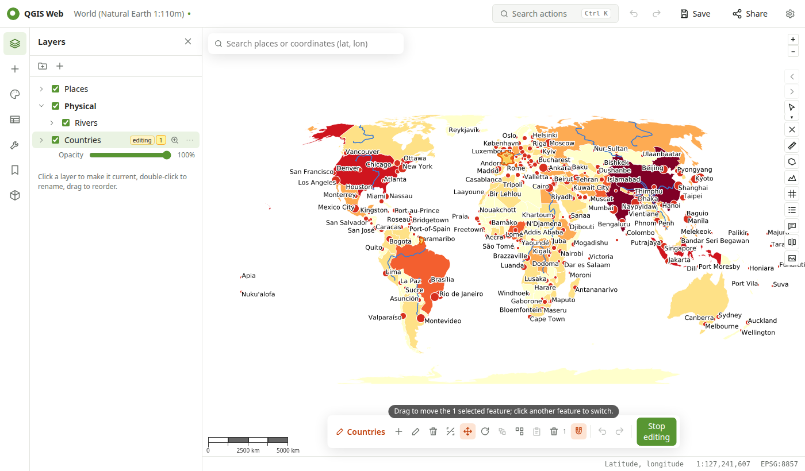

# Editing

Choose **Start editing** in the layer menu (⋯). Layers that aren't GeoPackages offer **Convert to GeoPackage and edit**, which copies them into the project's `data/` folder. Edits are written straight into the GeoPackage; QGIS Desktop reads them as they are.

## Tools

| Tool | How |
| --- | --- |
| Add feature | Click to add vertices, double-click to finish. Default values from the attribute form are filled in and the form opens. |
| Edit vertices | Click a feature, then drag its vertices; drag an edge to add one. |
| Delete feature | Click a feature. |
| Split | Draw a line across features (the selected ones, or every feature it crosses). |
| Move | Drag the selected features, or click a feature first. |
| Rotate | Drag around the selected features; the angle is shown while you drag. |
| Merge | Merges the selected features into the first one (its attributes are kept). |
| Explode | Splits selected multipart features into one feature per part. |
| Delete selected | Removes the selected features. |

**Snapping** (the magnet) snaps to vertices and edges of the visible layers.

## Attributes

Click a feature (with no tool active) to open its form: widgets, aliases, constraints and default values come from the project's attribute form configuration. Or edit cells in the attribute table.

## Copy and paste features

Select features in any layer and press ++ctrl+c++. Start editing the target layer and press ++ctrl+v++ (or the paste button): the features are added, reprojected to the layer's CRS, with the attributes whose names match.

## Undo and saving

++ctrl+z++ / ++ctrl+shift+z++ undo and redo each edit. **Stop editing** ends the session; the GeoPackage is already up to date, and **Save** keeps it with the project.
