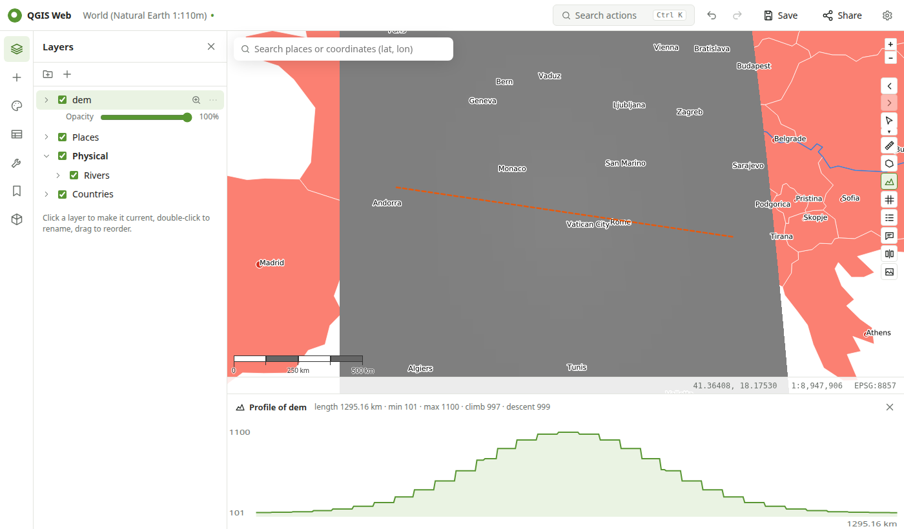
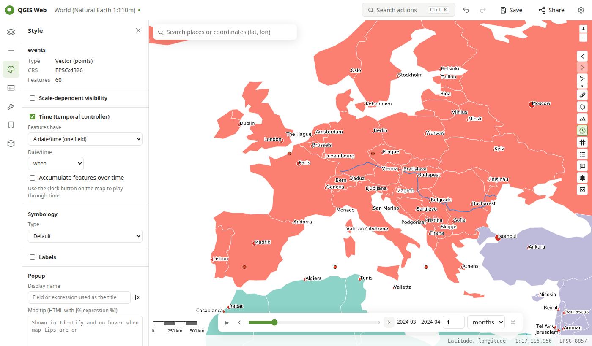

# Map tools

## Navigating

- Drag to pan, scroll or use **+ / −** to zoom. The scale bar and the scale in the status bar follow the map.
- **Previous / next view** (the arrows at the top of the map toolbar, or ++alt+arrow-left++ / ++alt+arrow-right++) step through the views you've visited, like QGIS's *Zoom Last / Zoom Next*.
- **Search** (top left) finds places (OpenStreetMap Nominatim) and coordinates, e.g. `48.85, 2.35` or `48°51′N 2°21′E`.
- **Zoom to layer**: the magnifier next to a layer in the tree.
- **Bookmarks** (left rail) save views in the project, as QGIS spatial bookmarks; Desktop shows them too.
- When a project opens, the map shows the view saved in it, as Desktop does (or the full extent, see [Settings](settings.md)).

## Coordinates

The status bar shows the pointer position; click it to switch between latitude/longitude, degrees-minutes-seconds, UTM, MGRS and the project CRS. **Right-click** the map to copy the position in any of these formats, identify, center or zoom there, or add a bookmark. The **grid** button draws a latitude/longitude grid with labels.

## Identify and map tips

Click a feature to see its attributes. On raster layers (GeoTIFF), Identify shows the pixel value of each band. Layers with a display name or HTML map tip (set in **Style → Popup**) show them in Identify, and on hover when **map tips** are on.

## Measuring

**Measure distance** and **Measure area**: click to add points, double-click to finish. Lengths and areas are geodesic (on the sphere) when the project CRS can be converted to WGS 84, and planar otherwise.

## Elevation profile

Add an elevation raster (a GeoTIFF DEM), choose **Elevation profile**, and draw a line. A chart opens below the map with the elevation along the line, its length, minimum, maximum, total climb and descent. Move the pointer over the chart to see the position on the map.

## Time slider

Layers with dates can be played through time, like QGIS's temporal controller:

1. In **Style → Time**, switch on the temporal controller for the layer and choose the date field (or start and end fields). These are the layer's QGIS temporal settings, saved in the project.
2. Click the **clock** in the map toolbar. Drag the slider, step, or press play; choose the step (hours to years).
3. Close the slider to show all features again.

## Compare

**Compare** shows a second map with layers of your choice: **swipe** (drag the divider) or **side by side**, with both maps moving together. Useful for before/after imagery or two styles of the same data.

## Legend

The **legend** button shows the QGIS legend of the visible layers on the map.

## Exporting an image

**Export map image** renders the current view with QGIS at 96 to 384 dpi, with an optional title and legend. Download it as PNG or copy it to the clipboard. Web layer credits are added at the bottom.
