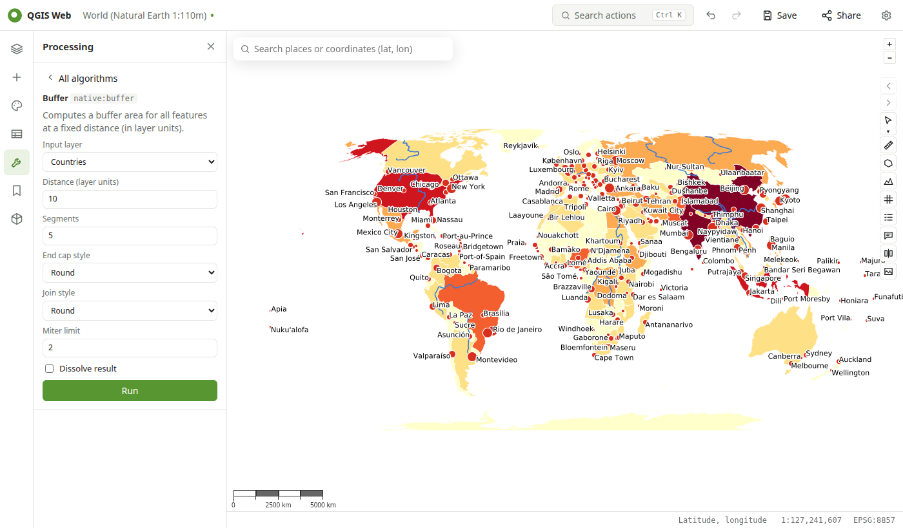

# Processing

Open **Processing** in the left rail, search an algorithm, fill in the parameters and **Run**. The result is added as a new layer, saved in the project's `data/processing.gpkg`. Every algorithm can also be started from the action search (++ctrl+k++).

Geometry operations run in [GEOS](https://libgeos.org), the library behind QGIS's native algorithms, compiled to WebAssembly; features, expressions and reprojection come from QGIS. The outputs are compared with QGIS Desktop's algorithms by `scripts/compare_processing.py`.

| Algorithm | QGIS id |
| --- | --- |
| Buffer (distance, segments, end cap, join style, dissolve) | `native:buffer` |
| Centroids | `native:centroids` |
| Point on surface | `native:pointonsurface` |
| Convex hull | `native:convexhull` |
| Bounding boxes | `native:boundingboxes` |
| Simplify | `native:simplifygeometries` |
| Fix geometries | `native:fixgeometries` |
| Dissolve (optionally by a field) | `native:dissolve` |
| Clip | `native:clip` |
| Difference | `native:difference` |
| Intersection | `native:intersection` |
| Union | `native:union` |
| Join attributes by location | `native:joinattributesbylocation` |
| Merge vector layers | `native:mergevectorlayers` |
| Points along geometry | `native:pointsalonglines` |
| Extract by expression | `native:extractbyexpression` |
| Extract by location | `native:extractbylocation` |
| Reproject layer | `native:reprojectlayer` |

## History

The **History** section lists the runs of the session; **Run again…** reopens an algorithm with the same parameters.
