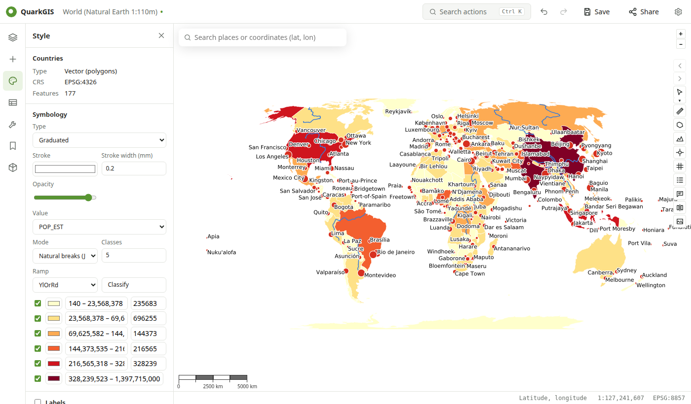

# Styling

Open **Style** in the left rail; it applies to the current layer (click a layer in the tree). Every change is written into the layer's QGIS renderer in the project, so Desktop shows the same thing.

## Vector layers

| Renderer | Options |
| --- | --- |
| Single symbol | Fill, stroke, width, size, opacity |
| Categorized | A field or expression, a color ramp, one class per value |
| Graduated | A numeric field, a ramp, the number of classes and the mode: equal interval, quantile, natural breaks (Jenks), pretty breaks, standard deviation, or manual (type the breaks) |
| Rule-based | Rules with QGIS expressions; can be created from categories |
| Heatmap | Radius and ramp, for points |
| Point cluster | Groups nearby points |

Classes can be shown or hidden, recolored and relabeled. Breaks are computed the same way as in QGIS.

New layers get a clean color instead of QGIS's random one, and are stacked points above lines above polygons. For a layer with a single symbol, the panel suggests one-click styles such as **Categorized by CONTINENT** (a text field with a few values) or **Graduated by POP_EST** (a number).

## Labels

Label with a field or an expression; choose font, size, color, a buffer (halo) and the placement. Layers with rule-based labels from Desktop keep them until you edit labels here.

**More options** (collapsed) holds the less common settings: the popup, scale-dependent visibility and time.

## Popups

**Display name** (the title in Identify) and an HTML **map tip** with `[% expression %]` placeholders, as in Desktop.

## Visibility and time

- **Scale-dependent visibility**: hide the layer when zoomed out or in beyond a scale; use the button to take the current map scale.
- **Time**: date fields for the [time slider](map.md#time-slider).

## Raster layers

Pseudocolor (one band with a color ramp), grayscale, hillshade (azimuth, altitude, z-factor, multidirectional) and RGB. For GeoTIFFs, the panel shows a histogram of the band with the min/max markers, and can reset to the band's range.

## Layer properties

Right-click a layer (or use its ⋯ menu) and choose **Properties…**, as in QGIS:

- **Information**: type, provider, source, CRS, extent, feature count, fields, bands.
- **Source**: rename the layer, and set a **provider feature filter** (an SQL `WHERE` clause, like QGIS's Query Builder) with **Test** to count the matching features first.
- **Fields**: names, types and lengths; edit the **aliases** shown in the table and forms.
- **Joins**: add the fields of another layer or table that shares a field, e.g. a CSV of statistics joined to countries by their code (QGIS vector joins: QGIS does the join, Desktop shows the same).
- **Rendering**: opacity and scale-dependent visibility.
- **Metadata**: the layer's title and abstract.

Everything is saved in the project, so Desktop shows the same.

## QML and copy/paste

- **Load QML… / Save QML**: QGIS layer style files, applied exactly as Desktop would.
- **Advanced (QML)**: edit the style XML directly.
- **Copy style / Paste style** in the layer menu (⋯) copy a style between layers.
- The **QGIS Hub** panel applies shared styles in one click.
