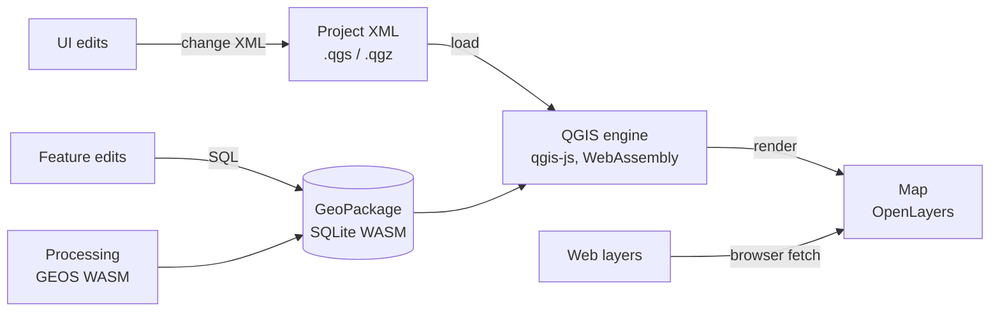

# How it works

- **The project file is the source of truth.** The open project is kept as its QGIS XML. Styling, layers, the tree, bookmarks and settings are changes to that XML, after which QGIS reloads it. What you see is exactly what gets saved, and Desktop reads it unchanged. New styles and layers are written from templates generated by QGIS itself.
- **Rendering** is done by QGIS core ([qgis-js](https://github.com/qgis/qgis-js), QGIS 4.2 compiled to WebAssembly) in the project CRS. It runs in several threads, which needs a cross-origin isolated page; a service worker provides that on GitHub Pages and caches the engine.
- **Web data.** The engine has no network access yet ([QEP #294](https://github.com/qgis/QGIS-Enhancement-Proposals/issues/294)). Tiles and images are drawn by OpenLayers in their place in the layer stack, reprojected with proj4; vector services are downloaded and handed to QGIS.
- **Editing** writes SQL into the layer's GeoPackage with the official SQLite WebAssembly build (it includes the R*Tree module GeoPackage spatial indexes need). Each edit stores its inverse for undo.
- **Processing** runs geometry in GEOS compiled to WebAssembly; features, expressions and reprojection come from QGIS.
- **CRS definitions** come from QGIS's `srs.db` inside the engine.
- **Storage**: projects saved in the browser and autosaves live in the Origin Private File System (OPFS).

## Limitations

- **Main thread.** QGIS runs on the page's main thread; qgis-js doesn't start in a Web Worker yet. Rendering itself uses the engine's threads.
- **Embedding** on other sites needs the host page to be cross-origin isolated (see [Sharing](guide/sharing.md#embedding)).
- **Labels** in the browser preview use the engine's built-in font; the chosen font is saved for Desktop. Placement can differ slightly from Desktop.
- **Web layers** drawn by the browser (tiles, WMS, vector tiles, MBTiles) don't use QGIS symbology; vector tiles use a default style and need a Web Mercator project.
- **Print layouts and atlases** aren't supported yet.
- **Processing** offers the algorithms listed in [Processing](guide/processing.md), not the whole QGIS toolbox; raster processing isn't available.
- **QGIS plugins** (Python) don't run.
